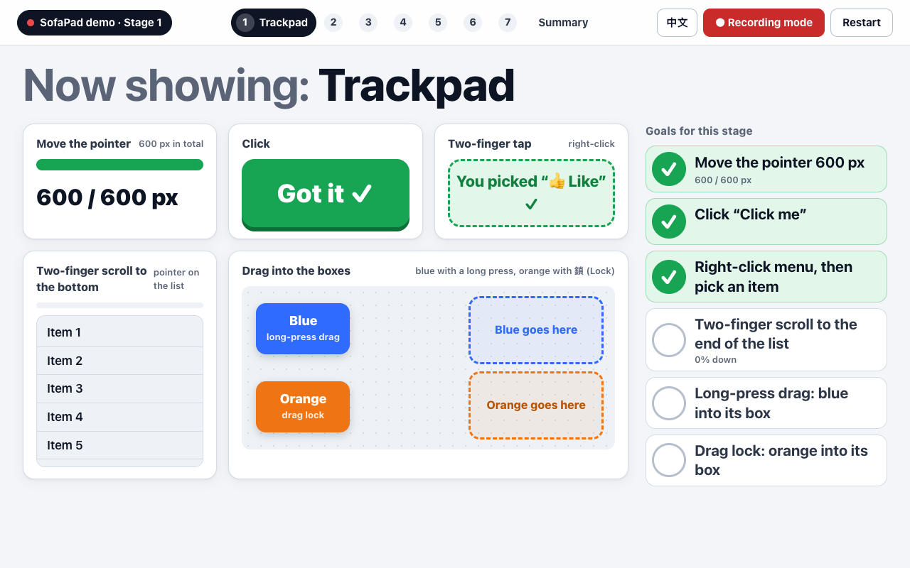

# SofaPad: your iPhone as a Mac keyboard and trackpad

**English** | [繁體中文](README.zh-TW.md)

This is for people who work from the sofa in Vision Pro with Mac Virtual Display. Rest the phone on your chest or lap and type with the **phone's normal keyboard** (Zhuyin, Pinyin, English, and the keyboard's dictation all work). The text shows up on the Mac. The other half of the phone is a trackpad: with one hand you can move the pointer, click, right-click, scroll, drag, and switch desktops with three fingers.

- **Mac side**: a menu-bar app, `SofaPad.app` (Swift, no third-party packages).
- **Phone side**: a web page, so there's no app to install. Open it in Safari, or add it to the Home Screen.
- Home Wi-Fi only, nothing goes through a cloud, and you have to pair before you can control anything.
- Before 4.0 this was called **Phone KeyMouse**. The older Python version (v0.2) is in [`legacy/v0.2-python/`](legacy/v0.2-python/). For the differences between the two, see [`docs/COMPARISON.md`](docs/COMPARISON.md).

## Try the demo page



Open [`demo/playground.html`](demo/playground.html) in a browser on the Mac (it works offline and collects nothing), then play it stage by stage from the phone. Each stage ticks itself when the page sees you do it. **English by default**; `?lang=zh` at the end of the address, or the 中文 button, switches it to Chinese.

1. **Trackpad**: move, click, right-click, two-finger scroll, long-press drag, drag lock.
2. **Typing**: live mode (on the English page an English sentence you can swipe; a word picked wrong is pointed out), batch mode with Send, Zhuyin, and dictation with the keyboard's 🎤 (nothing doubled).
3. **The box empties after you send.**
4. **Cursor pad**: arrow keys, a word at a time, ⇧ Select to fix a typo.
5. **Shortcuts**: ⌘A ⌘C ⌘V ⌘Z, and a screenshot pasted in (⌃⇧⌘4).
6. **Zoom and desktops**: pinch, three-finger swipes, Mission Control.
7. **The 4.3 layout**: ⏎ next to the cursor pad, editing the rows, the landscape panel.

At the end, a summary of every check and when it was done. Recording mode (`?rec=1`) hides the small print for a video. For a short video there is a recording version, `?video=1`: stages 1, 2, 5, 6 and 7 only, with English swipe typing and dictation in stage 2. Scripts for a 2–3 minute and a 60-second video: [`docs/DEMO-SCRIPT.md`](docs/DEMO-SCRIPT.md) ([中文](docs/DEMO-SCRIPT.zh-TW.md)). The release zip has the page too (`playground.html`).

## Latest version: 4.4.0

- **Download**: [GitHub Releases → SofaPad 4.4.0](https://github.com/rick-ray-wldd/sofapad/releases/tag/v4.4.0) (`SofaPad-4.4.0-macOS.zip`, macOS 13 or later, Apple silicon). Install: [`docs/INSTALL.md`](docs/INSTALL.md).
- **New in 4.4**: the phone page in **English or Chinese** (it follows the phone's language; switch in ⚙︎ → Language) and a **light or dark theme** (⚙︎ → Theme: System, Light or Dark). Both apply at once, without a reload, and are remembered on the phone. Nothing else changed.
- **New in 4.3**: the text box takes half the width, with the cursor pad and ⏎ next to it; the text row, the key row and the landscape panel can be edited; landscape has a side panel and a full-height trackpad; the demo page.
- **Defaults in 4.3**: no ⏎ on the key row (it's next to the cursor pad; add one in ✎ Edit if you want it); in portrait live mode the text box stays one line while you type, so the trackpad keeps at least 290 px; the landscape panel is on the left (on the right in left-handed mode).
- All changes: [`CHANGELOG.md`](CHANGELOG.md). Release notes: [`docs/release/4.4.0.md`](docs/release/4.4.0.md).

---

## First-time setup (about 10 minutes)

Every step says what you'll see. Screen names follow macOS 15 / 26 / 27 (English names are used here).

### 1. Get the app

**A. Build it yourself (recommended: an app you build yourself isn't blocked by Gatekeeper)**

1. Open Terminal and run `swift --version`.
   - **You'll see** a version number, and you can go to the next step. If a prompt says the command line developer tools need to be installed, click Install and wait for it to finish (about 5-10 minutes).
2. Download and build:
   ```bash
   git clone https://github.com/rick-ray-wldd/sofapad.git
   cd sofapad
   ./tools/build-app.sh
   ```
   - **You'll see** `Built …/dist/SofaPad.app` on the last line.
3. In Finder, drag `dist/SofaPad.app` into the Applications folder (permissions are more reliable that way).

**B. Use a `SofaPad.app` someone else built** (AirDrop, download): that works, but macOS will block it the first time you open it. Follow step 2. From a release zip (`SofaPad-<version>-macOS.zip`, Apple silicon; the latest is [4.4.0](https://github.com/rick-ray-wldd/sofapad/releases/tag/v4.4.0)): [`docs/INSTALL.md`](docs/INSTALL.md), with how to check its SHA-256.

### 2. Open the app the first time (if Gatekeeper blocks it)

1. In Applications, double-click **SofaPad**.
   - **You'll see** `⌨︎🖱` appear in the menu bar at the top right, and a small "**SofaPad Pairing (SofaPad 配對)**" window in the middle of the screen with a 6-digit pairing code and a QR code. There's no Dock icon, and that's normal.
2. If you get "**"SofaPad" Not Opened** / Apple could not verify… is free of malware":
   1. Click Done. Don't click Move to Trash.
   2. Open **System Settings > Privacy & Security**, and scroll to the Security section at the bottom.
   3. **You'll see** "SofaPad was blocked to protect your Mac." Click "**Open Anyway**", then enter your password or use Touch ID.
   4. Double-click SofaPad again, and click Open in the window that appears.
   - On recent macOS, right-click > Open no longer skips this check, so use the method above. You only need to do it once.

### 3. Grant Accessibility permission (only you can turn it on, about 1 minute)

macOS requires you to allow any program that presses keys or moves the mouse for you.

1. The first time you open the app, **you'll see** ""SofaPad" would like to control this computer using accessibility features." Click "**Open System Settings**".
   - If you don't see that dialog, click `⌨︎🖱` in the menu bar, then "⚠️ Accessibility permission isn't on yet: Open System Settings… (尚未開啟『輔助使用』權限：打開系統設定…)".
2. **System Settings > Privacy & Security > Accessibility** → turn on the switch for **SofaPad** (it asks for your password or Touch ID).
   - If it's not in the list, click **+** at the bottom and choose `SofaPad.app` in Applications.
3. You don't need to restart the app. **You'll see** the ⚠️ in the menu bar go away, and the red notice on the phone disappears by itself.

> After you switch to a new version or rebuild, the phone may say "The Mac hasn't turned on Accessibility permission" again. In the same list, select SofaPad, click **-** to remove it, then add it again with **+**. macOS identifies an app by its signature, and an app you build yourself gets a different signature every time.

### 4. Firewall and Local Network

- **macOS firewall** (System Settings > Network > Firewall), if it's on: the first time the phone connects, **you'll see** "Do you want the application "SofaPad" to accept incoming network connections?" Click "**Allow**". If the firewall is off, it won't ask. If you clicked "Deny" before, the phone keeps loading after you scan the QR code: in Firewall > Options, set SofaPad to allow incoming connections.
- **Local Network** (System Settings > Privacy & Security > Local Network): SofaPad only accepts connections from your phone. It doesn't connect out to other devices, so macOS doesn't ask about this (Apple TN3179). If SofaPad is listed there, it doesn't matter whether it's on or off.

### 5. Start at login (optional)

**System Settings > General > Login Items & Extensions** (Login Items) → under "Open at Login", click **+** and choose `SofaPad.app` in Applications.

### 6. Scan with the iPhone, pair, and add to the Home Screen

1. Put the iPhone and the Mac on the **same Wi-Fi** (guest networks often block devices from reaching each other).
2. Point the iPhone **camera** at the QR code in the "SofaPad Pairing" window on the Mac, then tap the address that pops up.
   - **You'll see** Safari open SofaPad with a **green dot** and the Mac's name at the top left. That means you're paired. (The QR code contains a one-time pairing code, valid for 10 minutes.)
   - If the pairing window is already closed: click `⌨︎🖱` in the menu bar, then "**Pair a new phone (配對新手機)**", and a new pairing window opens.
   - If you're not at the Mac (for example, you're wearing Vision Pro): open the page on the phone and tap "**Show a code on the Mac**". A 6-digit code appears on the Mac screen (the virtual display in Vision Pro). Type it in.
3. **Add to Home Screen** (recommended): in Safari, tap Share at the bottom, then "**Add to Home Screen**", name it SofaPad, and tap Add. After that, opening it from the Home Screen is full screen.
   - A Home Screen app stores its data separately from Safari, so **the first time you open it from the Home Screen you have to pair again**: tap "Ask the Mac for a pairing code" and type the 6 digits shown on the Mac.
4. After that, it connects automatically when you open it, with no code to enter.

**There is only one address**: the QR code holds the Mac's IP address (for example `http://192.168.1.23:8765/`), so scanning it always works. The menu bar adds just one more address, using the `.local` name, for when the router has changed the Mac's IP and the old address no longer opens. Addresses for the other network interfaces are tucked under "**Advanced (進階)**" in the menu bar. You won't normally need them.

### 7. Check the version

- **Mac**: click `⌨︎🖱` in the menu bar. The first line is the version, for example "SofaPad 4.4.0 (build 2026-10-31 16:00)".
- **iPhone**: tap ⚙︎ at the top right (in landscape it's in the side panel's top row, or in the column of small buttons when the panel is closed). The top line reads "Web page 4.4.0 (build …) · Mac app 4.4.0 (build …)" (網頁 4.4.0（建置 …）・Mac App 4.4.0（建置 …） in Chinese).
- If the two versions differ, or it says "old (no version information)": install the new app on the Mac, then reload the page. For the Home Screen app, swipe it away in the app switcher and open it again.

### 8. Common problems

| Problem | What to do |
|---|---|
| The phone can't open the page | Are both on the same Wi-Fi? Is SofaPad running on the Mac? Try the `.local` address in the menu bar. If it still fails, see Troubleshooting below |
| The phone says "The Mac hasn't given SofaPad the Accessibility permission yet" | Step 3. After a new version, remove it and add it again |
| The phone says "The Mac is on its lock screen" | Unlock the Mac first. While it's locked, the phone's input is paused for safety |
| The top left turns into a yellow dot, "Reconnecting…" | It reconnects by itself (it tries up to once every 2 seconds). Text you type while disconnected is **not** sent after it reconnects (so it can't end up in another window), and the phone tells you what wasn't sent |
| You want to check you have the new version | Step 7 |

---

## Upgrading from Phone KeyMouse (the old name) to SofaPad

After the rename, macOS treats the app as a new one, so you have to grant Accessibility permission again.

1. **Quit the old one**: click `⌨︎🖱` in the menu bar, then "Quit Phone KeyMouse (結束 Phone KeyMouse)".
2. Move `PhoneKeyMouse.app` from Applications to the Trash. If you set it to start at login, remove it from Login Items.
3. **System Settings > Privacy & Security > Accessibility**: select "Phone KeyMouse" and click **-** to remove it.
4. Open `SofaPad.app` and turn on **SofaPad** as in step 3 above.
5. **Phones that are already paired don't need to pair again**: the first time SofaPad starts, it copies over Phone KeyMouse's pairing data (only `devices.json`). The address and port haven't changed, so reloading the page on the phone is enough.
6. The Home Screen icon is still named "KeyMouse": delete the icon and use "Add to Home Screen" again, and it becomes SofaPad (you'll have to pair again).
7. **What the old 🎤 voice key left behind** (only in v3; 4.0 removed the voice key. Clean these up yourself if you don't need them, because SofaPad won't touch them):
   - iPhone: **Settings > General > VPN & Device Management** → tap the "Phone KeyMouse (your Mac's name)" profile → "**Remove Profile**".
   - Mac: delete the folder `~/Library/Application Support/PhoneKeyMouse/` (its `tls/` holds the certificate and private key from back then) and `~/Library/Logs/PhoneKeyMouse.log`.

---

## 3-minute real-device check: "the last sentence jumps into the next window" no longer happens

Before 4.0, after you sent some text and switched to another window, the previous text could sometimes be typed again into the new window (for example, what you wrote in Orca ended up in LINE), and typing stuttered. For how 4.0 fixes this, see [`docs/DEVELOPMENT.md`](docs/DEVELOPMENT.md#40-stale-text-and-lag). Do the following once to confirm:

**Prepare** (don't use a real chat, so you don't send the test sentence to someone): open two windows on the Mac to stand in for "Orca" and "LINE", for example a new note in Notes and a new document in TextEdit. First check with step 7 that the phone and the Mac are both 4.0.0 or later.

1. **Batch mode + dictation** (about 1 minute): click into Notes. On the phone, switch to "Batch", tap 🎤 on the keyboard and say "This is the first paragraph; it must not appear in the second window." (Chinese dictation works too.) Tap "Send". Right away, use the phone's trackpad to click into TextEdit, type a single "OK" on the phone, and tap "Send".
   - **Correct**: TextEdit contains only "OK".
2. **Live mode** (about 1 minute): switch back to "Live". Click into Notes, type or say a sentence, and press return. Switch to TextEdit right away (with the trackpad, or by looking and tapping in Vision Pro), and type a single "OK".
   - **Correct**: TextEdit contains only "OK".
3. **Switching apps, undo gestures, disconnecting** (about 1 minute):
   - Swipe up from the bottom edge of the phone to the Home Screen, then go back to SofaPad and type one character → no old text appears.
   - With the keyboard open, swipe left or right with three fingers on the trackpad, or shake the phone: **you'll see** "The phone's text box has no undo / redo" at the top of the phone, and no extra text appears on the Mac.
   - Quit SofaPad on the Mac and open it again: the phone **shows** "Reconnecting…", turns back to a green dot within a few seconds, and shows "Reconnected to the Mac". Text you type during those few seconds of disconnect isn't sent later, and the phone tells you what wasn't sent.

If any step shows old text: ⚙︎ → "Input log" → "Select all" → copy it and send it to the developer (the log stays on your phone and is never uploaded automatically).

---

## Using it

First **unlock the Mac**, put on Vision Pro and connect to Mac Virtual Display, and open SofaPad from the Home Screen. The **green dot** at the top left means connected, and the number next to it is the latency (ms).

**Recommended posture**: lie back or half-recline, rest the phone flat on your chest or belly, rest your elbows on the sofa or a cushion, and move only your thumb.

### Trackpad

| To do this | Do this |
|---|---|
| Move the pointer | Slide one finger. Slow slides are precise, and one quick flick crosses a whole wide screen |
| Left click | Tap once (tap twice to double-click) |
| Right click | Tap once with two fingers together, or press "Right click" at the bottom |
| Scroll | Slide two fingers up or down. With one hand, use the ⇵ strip on the right. It coasts for a bit after you let go |
| Drag | Press and hold for about half a second until "Dragging" appears, then slide. Or press "Drag lock" → slide (you can do it in several strokes) → press again to release |
| Switch desktops | Swipe three fingers left → the desktop on the right. Swipe right → the desktop on the left (same direction as a Mac trackpad) |
| Mission Control / App Exposé | Swipe three fingers up / down |
| Zoom in and out | Spread two fingers = ⌘=, pinch = ⌘− |
| Back / forward (off by default) | After you turn on "Two-finger quick swipe left / right" in ⚙︎, swipe two fingers quickly right = ⌘[, left = ⌘] |

> The three-finger gestures are recognized on the phone, which then sends shortcuts the Mac already has (⌃← ⌃→ ⌃↑ ⌃↓). Those shortcuts have to be turned on in macOS: **System Settings > Keyboard > Keyboard Shortcuts… > Mission Control**, and check "Mission Control", "Application windows", "Move left a space", and "Move right a space". If a three-finger swipe does nothing, the phone tells you why (the shortcuts are turned off, or the Mac has only one desktop).

### Typing

- Tap the text box at the bottom and type on the phone's keyboard as usual.
- **Live mode** (the default): each character you pick appears on the Mac. While Zhuyin is still composing, nothing is sent. Delete on the phone and the Mac deletes too. The keyboard's return key is the Mac's Enter.
  - **Keyboard dictation (🎤)**: dictation keeps revising words as you speak, so SofaPad waits until you **pause for about 0.7 seconds** and then sends the corrected whole passage (to avoid doubled text on the Mac). If you tap the trackpad, press a key on the key row, or make a gesture within that 0.7 seconds, the text is sent first and then the action runs, so the text always lands in the original window.
  - If the Mac is still typing the previous passage (for example, the Mac has Zhuyin turned on, so every passage has to be pasted), text you type in the meantime waits for it to finish and is then sent in one go. It doesn't pile up on the Mac.
  - **When the text box empties** (4.2): pressing Enter, tapping the trackpad (for example, clicking a "Send" button in a Mac app with it), pressing a key or shortcut on the key row, a gesture, the cursor pad, closing the keyboard or switching to another app all mean "this piece is done": anything not sent yet goes to the Mac first, then the box empties, and you start the next piece from an empty box. Old text is never sent again. After Enter, a trackpad tap or a key, the keyboard stays up so you can keep typing. While Zhuyin is still composing, the box isn't emptied; that happens once the chosen characters are sent.
- **Batch mode**: tap "Live", the leftmost item below the text box, to switch to "Batch". Type and edit on the phone first, then tap "Send" (which also dismisses the keyboard; if Zhuyin is still composing, it waits until the chosen characters are in the box and sends them too). The keyboard's own send key also sends, and keeps the keyboard up. If you close the keyboard without sending, the text stays in the box as a draft. It suits long paragraphs and dictation, and in settings you can choose to press Enter automatically after sending. Switching between Live and Batch does **not** send the text in the box.
- **The text box's row** (4.3): the text box takes half the width. The other half has the cursor pad "◀ Cursor ▶" and ⏎ (Enter) to its right. ⏎ sends what's still waiting, then presses Enter on the Mac, and the keyboard stays up. You can reorder these cells, take them out or add other keys (see "Customize" below).
- **Cursor pad** (4.2): "◀ Cursor ▶" to the right of the text box. Hold it for about 0.3 seconds (the phone gives a short buzz), then drag left, right, up or down (your finger can leave the pad): the text cursor on the Mac follows with the arrow keys, at most about 30 presses a second, and stops the moment you lift your finger. A quick flick jumps a word at a time (⌥←→). Tap "⇧ Select" (since 4.3 an ordinary key on the key row that you can move or remove), or tap with a second finger while dragging (works even without the key), to select text with Shift + arrows; type to replace the selection. The iPhone keyboard's own "hold the space bar to move the cursor" only moves the cursor inside the phone's text box, which the Mac never sees, so SofaPad has its own pad.
- **Text that was already sent isn't sent again**: after you send or press Enter, if the iPhone puts the text you just sent back into the box, SofaPad removes it right away. The phone's input box also has "undo / redo" turned off (shake, three-finger swipe, ⌘Z), because it would bring back text you already sent. To undo on the Mac, use the ⌘Z key on the key row or the shortcut panel.
- **Key row**: the row under the text box scrolls left and right: Live/Batch, ⌘ Shortcuts, then ⇧ Select (for the cursor pad), esc, tab, ⌫, arrow keys, ⌘ ⌥ ⌃ ⇧, space, ⌦ (⏎ moved next to the cursor pad in 4.3). Keys are sent when you lift your finger, and ⌫ and the arrow keys repeat while held. Tap ⌘ so it lights up, then type c on the phone keyboard, and ⌘C is sent.
- **Customize** (4.3): "✎ Edit" at the end of the key row (or ⚙︎ → "Edit the text row and key row…"). Three tabs: **Text row** (the cells next to the text box, at most 6), **Key row**, and **Landscape panel** (extra keys shown only in landscape). Hold ≡ and drag to reorder, and tap ✕ to remove. In the list below, tap an item to add it (the cursor pad and ⇧ Select, common keys, arrows, modifier keys, copy and paste, screenshots, switching, My shortcuts, F1-F12). The cursor pad and ⇧ Select exist once each: adding one to another row moves it there. There's also "+ Add custom button" and "Restore all defaults". It's saved on this phone. A key row you customized in 4.2 is kept as it was when you update, with ⇧ Select in front where 4.2 had it.

### Shortcut panel

Open it with "⌘ Shortcuts" on the key row. It covers the trackpad, and ✕ at the top right closes it.

| Group | Contents |
|---|---|
| Mine | Shortcuts you added yourself ("Customize…" at the top right of the panel → "+ Add shortcut"; you can export / import JSON) |
| Edit | ⌘C, ⌘V, ⌘X, ⌘Z, ⇧⌘Z, ⌘A |
| Screenshot | ⇧⌘3, ⇧⌘4, ⇧⌘5, ⌃⇧⌘3 / ⌃⇧⌘4 (save to the clipboard) |
| Switch | ⌘Tab, ⌘Space, Mission Control, App Exposé, the desktop to the left / right |
| Other | ⌘S, ⌘F, ⌘T, ⌘W, ⌘[, ⌘], ⌘=, ⌘−, ⌘←, ⌘→, ⌥⌫ |

### Landscape: trackpad and side panel (4.3)

Turn the phone sideways: the trackpad (with the scroll bar on its right edge) takes one side at full height, and a side panel the other: on top ● connection status (tap to reconnect), Aa / ⌄ keyboard, "Lock" for drag lock, ⚙︎ settings and ‹ to close the panel; then the text box with the cursor pad and ⏎; then a grid of keys: the key row, followed by extra shortcuts (⌘C ⌘V ⌘X ⌘Z ⇧⌘Z ⌘A ⌘Tab, Mission Control, the desktop to the left / right, screenshot to the clipboard, ⌘S), which you can change in the "Landscape panel" tab. The panel is on the left; in left-handed mode it's on the right. The trackpad stays at least as wide as in portrait, and while typing it keeps the full height above the keyboard.

‹ closes the panel and the whole screen becomes the trackpad (as in 4.2), with a column of small buttons; › there opens the panel again. While closed, the panel still comes back while you type (it has the text box). For full screen without Safari's address bar, open it from the Home Screen.

### Settings (⚙︎)

The version is at the top. Then **Language** (Auto, English, 中文) and **Theme** (System, Light, Dark), both 4.4: Auto follows the phone's language (Chinese if it is Chinese, English otherwise) and System follows the phone's light or dark appearance, also while the page is open. A change applies at once, without reloading or dropping the connection (text in the box stays), and is remembered on this phone. On a Home Screen app the iPhone's status bar takes the new theme the next time the app opens. Then: pointer speed, acceleration, scroll speed, reverse scrolling, left-handed mode, long-press drag, three-finger swipe (on by default), pinch to zoom (on by default), two-finger quick swipe left/right (off by default), haptic feedback, phone autocorrect, show the side panel in landscape, edit the text row and key row, input log (stored only on the phone, for the developer to debug), and make this phone forget the pairing.

### Small tips

- A web page can't keep the phone screen awake. If the phone keeps auto-locking, raise the time under iPhone **Settings > Display & Brightness > Auto-Lock**.
- Only one phone can control the Mac at a time. When another phone signs in, the original one shows "Another phone has taken over", and you can tap the status bar at the top to take it back.
- When the phone switches to another app or locks, any mouse button held down on the Mac is released automatically.

---

## Security

- It only accepts connections from the same local network (home Wi-Fi, a hotspot). The internet can't reach it, and nothing goes through a cloud. For IPv6, only addresses in the Mac's own network (/64) are accepted. A device outside the local network only gets a short explanation page (403) and can't control the Mac.
- **Tailscale**: when the phone has Tailscale on, its connection may arrive from a Tailscale address (100.64.0.0/10), which is refused by default. If the phone has Tailscale on, turn it off, or turn on "允許 Tailscale 裝置" (Allow Tailscale devices) in the Mac's menu bar (off by default). With it on, Tailscale devices are accepted too, but they still have to pair; every device in the same tailnet can reach the pairing screen, so turn it off when you don't need it.
- The first time, you enter the pairing code shown on the Mac screen (or scan the QR code in the pairing window; the code is valid for 10 minutes). After that, the phone proves its identity with a one-time challenge (HMAC), and the long-term secret never appears on the Wi-Fi again. The QR code under "Scan with iPhone (用 iPhone 掃描)" in the menu bar contains only the address, not the pairing code.
- Five wrong pairing codes lock it for 30 seconds, and the lockout doubles after that. After too many wrong tries, the Mac changes the code automatically and closes pairing. In the menu bar you can "Forget all paired phones (忘記所有已配對手機)".
- While the Mac is locked, it types nothing. Text that reaches the Mac more than 3 seconds late (a stalled connection) isn't typed, so it can't land in a window you've already switched to.
- **Limitation**: the connection is plain http / ws, with no encryption (4.0 removed the https that v3 added for the voice key). If someone on the same Wi-Fi attacks actively, they could in theory see or hijack the connection. Use it at home or on a network you trust, and on public Wi-Fi use your phone's hotspot instead.

---

## Troubleshooting

| Problem | What to do |
|---|---|
| The phone can't open the page | Same Wi-Fi? Is the app running on the Mac? Try the `.local` address. "Advanced" in the menu bar shows the status of each network interface (for example, "169.254 means it didn't get an IP from the router") |
| You scanned the QR code and Safari keeps loading or stays black | The phone can't reach the Mac. Three common causes: **(1) VPN on the phone**: with Tailscale (or another VPN) on, the phone's connection may go through the VPN instead of the Wi-Fi. If the phone has Tailscale on, turn it off, or turn on "允許 Tailscale 裝置（100.64.0.0/10，仍要配對）" (Allow Tailscale devices; they still have to pair) in the SofaPad menu on the Mac (off by default). **(2) Not on the same network**: the phone is on a guest network, on cellular or on another Wi-Fi, or the router has AP isolation (client isolation) on, so devices on the same Wi-Fi can't reach each other. **(3) The Mac changed networks and its IP changed**: from 4.1, the QR code, the menu and the pairing window switch to the new IP by themselves; just scan again. Also check that the macOS firewall allows SofaPad (step 4). **How to tell**: if the phone shows the page "Your phone is not on the Mac's local network (你的手機不在 Mac 的區網裡)", the Mac refused it, and the menu bar shows "最近拒絕的連線" (last refused connection) with the address. If nothing shows on the Mac and Safari keeps loading, the connection never reached the Mac (VPN route, guest network, AP isolation, firewall). **Log**: `~/Library/Logs/SofaPad.log`; look for "拒絕非區網來源" (refused) and "網路變了" (network changed) |
| Old text jumps out when you type somewhere else, or typing doesn't reach the Mac | Check that the phone and the Mac are both 4.2 or later (step 7). From 4.2 the text box empties after a trackpad tap, a key or closing the keyboard, so old text is never sent again, and closing the keyboard in the middle of Zhuyin no longer gets stuck. If it still happens, open ⚙︎ → "Input log", select all, and send it to the developer |
| "Scan with iPhone" in the menu bar says "Can't find a local network IP" | The Mac isn't on Wi-Fi yet, or is on a network that can't be used. The QR code uses the `.local` name at first. Once you're on Wi-Fi, reopen the menu and it switches to the IP |
| A "Secure Input" notice appears while typing | The Mac is taking a password (a password field, or Terminal's "Secure Keyboard Entry"). macOS blocks simulated keyboard input, but the mouse still works |
| The Mac also has Zhuyin turned on | SofaPad switches to sending text by "paste" automatically (and restores the clipboard afterwards). The smoothest setup: keep the Mac on ABC and type all Chinese on the phone |
| An app can't type Chinese | A few apps ignore simulated Unicode key events. Use Batch mode and type more than 200 characters (that uses paste), or start from Terminal with `--text-mode paste` |
| The phone says "What you typed while disconnected didn't reach the Mac" or "… didn't reach the Mac and won't be sent later" | That text didn't reach the Mac and isn't resent automatically. In Batch mode the text goes back into the box: check which window on the Mac should get it, then tap "Send" again. Live mode clears the box, so continue typing from where the Mac is now |
| The phone says "The phone's text box has no undo / redo" | That's normal: the iPhone's undo (shake, three-finger swipe or double-tap, ⌘Z) would bring back text you already sent, so it's turned off. To undo on the Mac, use the ⌘Z key |
| Doubled text on the Mac during dictation ("然後然後") | Check that you're on 4.0 (step 7). In Live mode, tap 🎤 on the keyboard and say "然後現在需要按步驟，先按鍵盤打開來，然後鍵盤內建的錄音功能可以直接用。" (a Chinese test sentence: "Then now we need to go step by step: first open the keyboard, then the keyboard's built-in dictation can be used directly."), pause, and see whether the Mac shows it word for word. If not, copy the "Input log" and send it to the developer; in the meantime switch to Batch mode |
| Three-finger swipe doesn't switch desktops | The phone says why: the shortcuts are turned off (System Settings > Keyboard > Keyboard Shortcuts… > Mission Control), or there's only one desktop (swipe three fingers up to open Mission Control and click "+" at the top to add one) |
| The latency number is large (> 50 ms) | Weak Wi-Fi signal or a router power-saving mode. Move closer to the router, or switch to 5 GHz |
| Where's the log file | `~/Library/Logs/SofaPad.log` (when the app is opened from Finder). Each launch records the version and "Network interfaces: …" |

---

## Showing it to someone (demo page)

See [Try the demo page](#try-the-demo-page) at the top.

## Development

To run it from Terminal, run the tests, and see the file layout: [`docs/DEVELOPMENT.md`](docs/DEVELOPMENT.md). The development process is recorded in [`process/`](process/) (in Chinese).

## License

MIT. See [LICENSE](LICENSE).
