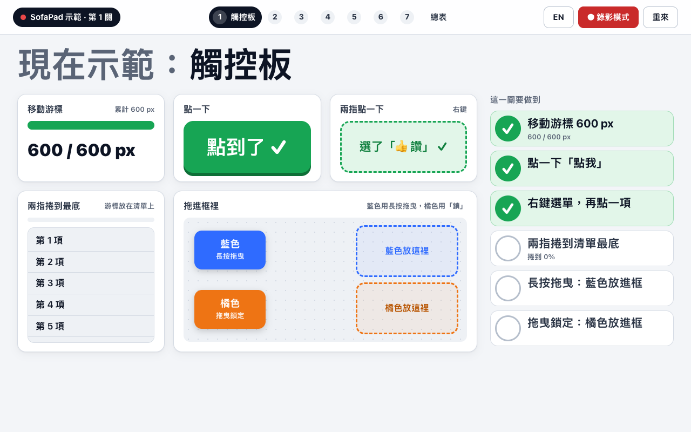

# SofaPad：iPhone 當 Mac 的鍵盤和觸控板

[English](README.md) | **繁體中文**

給戴 Vision Pro、在沙發上用 Mac Virtual Display 工作的人：手機放在胸口或腿上，用**手機平常的鍵盤**（注音、拼音、英文、鍵盤的聽寫都可以）打字，字直接出現在 Mac 上；手機另一半是觸控板，一隻手就能移動游標、點擊、右鍵、捲動、拖曳、三指切桌面。

- **Mac 端**：選單列小程式 `SofaPad.app`（Swift，沒有任何第三方套件）。
- **手機端**：網頁，不用裝 App。Safari 打開就能用，也可以「加入主畫面」。
- 只走家裡的 Wi-Fi，不經過任何雲端；要先配對才能控制。
- 4.0 以前叫 **Phone KeyMouse**；更早的 Python 版（v0.2）在 [`legacy/v0.2-python/`](legacy/v0.2-python/)，兩版的差異見 [`docs/COMPARISON.md`](docs/COMPARISON.md)。

## 先玩玩看：示範場



在 Mac 上用瀏覽器打開 [`demo/playground.html`](demo/playground.html)（不用連網，也不收任何資料），再用手機一關一關玩。每個功能一關，頁面看到你做到就自動打勾。**預設英文，可以切中文**：網址最後加 `?lang=zh`，或按右上角的「中文」。

1. **觸控板**：移動、點擊、右鍵、兩指捲動、長按拖曳、拖曳鎖定。
2. **打字**：即時模式、整段模式＋送出、注音、鍵盤 🎤 聽寫（不會疊字）。英文版的即時模式是一句英文，可以用滑的，滑錯的字會告訴你是哪一個。
3. **送出後自動清空**。
4. **游標板**：方向鍵、一次跳一個字詞、用「⇧ 選取」改錯字。
5. **快捷鍵**：⌘A ⌘C ⌘V ⌘Z，和截圖貼上（⌃⇧⌘4）。
6. **縮放與桌面**：捏合、三指滑、Mission Control。
7. **4.3 新排版**：游標板旁邊的 ⏎、編輯按鍵、橫拿側欄。

最後有總表，列出每一項和完成的時間。「錄影模式」（`?rec=1`）會把小字藏起來，適合錄影。錄短片用的「錄影精簡版」：網址加 `?video=1`，只有第 1、2、5、6、7 關，第 2 關是英文滑動輸入和聽寫。2–3 分鐘和 60 秒兩種錄影腳本：[`docs/DEMO-SCRIPT.zh-TW.md`](docs/DEMO-SCRIPT.zh-TW.md)（[English](docs/DEMO-SCRIPT.md)）。安裝包（zip）裡也有一份 `playground.html`。

## 最新版：4.4.0

- **下載**：[GitHub Releases → SofaPad 4.4.0](https://github.com/rick-ray-wldd/sofapad/releases/tag/v4.4.0)（`SofaPad-4.4.0-macOS.zip`，macOS 13 以上，Apple 晶片）。安裝：[`docs/INSTALL.md`](docs/INSTALL.md)。
- **4.4 新功能**：手機網頁有**中文和英文**（跟著手機的語言；⚙︎ →「語言」可以換），還有**淺色和深色主題**（⚙︎ →「主題」：系統、淺色、深色）。切換馬上生效，不用重新整理，手機會記住。其他都和 4.3 一樣。
- **4.3 新功能**：輸入框半寬，旁邊是游標板和 ⏎；輸入列、按鍵列、橫拿側欄都可以自己排；橫拿有側欄和全高的觸控板；示範場。
- **4.3 的預設**：按鍵列不放 ⏎（在游標板右邊；要的話到「✎ 編輯」加）；直拿、即時模式打字時輸入框一行，觸控板保持 290 px 以上；橫拿側欄在左邊（左手模式在右邊）。
- 完整更新紀錄：[`CHANGELOG.md`](CHANGELOG.md)（英文）。發行說明：[`docs/release/4.4.0.md`](docs/release/4.4.0.md)（中英）。

---

## 第一次使用（約 10 分鐘）

每一步都寫了「會看到什麼」。畫面上的文字以 macOS 15／26／27 的繁體中文介面為準，英文介面的名稱寫在括號裡。

### 1. 拿到 App

**A. 自己建置（推薦：自己建的 App 不會被 Gatekeeper 擋）**

1. 打開「終端機」，執行 `swift --version`。
   - **會看到**版本號就可以下一步；如果跳出「需要安裝命令列開發者工具」，按「安裝」，等它跑完（約 5–10 分鐘）。
2. 下載並建置：
   ```bash
   git clone https://github.com/rick-ray-wldd/sofapad.git
   cd sofapad
   ./tools/build-app.sh
   ```
   - **會看到**最後一行 `Built …/dist/SofaPad.app`。
3. 在 Finder 把 `dist/SofaPad.app` 拖到「應用程式」資料夾（權限設定比較穩定）。

**B. 用別人建好的 `SofaPad.app`**（AirDrop、下載）：可以，但第一次打開會被擋，照第 2 步做。從發行的 zip（`SofaPad-<版本>-macOS.zip`，Apple 晶片；最新是 [4.4.0](https://github.com/rick-ray-wldd/sofapad/releases/tag/v4.4.0)）安裝：見 [`docs/INSTALL.md`](docs/INSTALL.md)，裡面有怎麼核對 SHA-256。

### 2. 第一次打開 App（被 Gatekeeper 擋時）

1. 在「應用程式」雙擊 **SofaPad**。
   - **會看到**：螢幕右上角選單列出現 `⌨︎🖱`，畫面中間跳出「**SofaPad 配對**」小視窗（6 位數配對碼和一個 QR code）。沒有 Dock 圖示是正常的。
2. 如果跳出「**無法打開 "SofaPad"**／Apple 無法驗證……是否包含惡意軟體」：
   1. 按「完成」（Done），不要按「丟到垃圾桶」。
   2. 打開 **系統設定 → 隱私權與安全性**（Privacy & Security），捲到最下面「安全性」。
   3. **會看到**「已阻擋 "SofaPad" 以保護你的 Mac」→ 按「**仍要打開**」（Open Anyway），輸入密碼或用 Touch ID。
   4. 再雙擊一次 SofaPad，在跳出的視窗按「打開」。
   - 新版 macOS 用「右鍵 → 打開」已經不能略過這個檢查，要用上面的方法。這只要做一次。

### 3. 給「輔助使用」權限（只能你自己開，約 1 分鐘）

macOS 規定：替你按鍵盤、動滑鼠的程式，要先由你允許。

1. 第一次打開時 **會看到**「"SofaPad" 想要使用輔助使用功能來控制這台電腦」→ 按「**打開系統設定**」。
   - 沒看到這個對話框：點選單列 `⌨︎🖱` →「⚠️ 尚未開啟『輔助使用』權限：打開系統設定…」。
2. **系統設定 → 隱私權與安全性 → 輔助使用**（Accessibility）→ 打開 **SofaPad** 的開關（要輸入密碼或 Touch ID）。
   - 清單裡沒有：按下方的 **＋**，選「應用程式」裡的 `SofaPad.app`。
3. 不用重開 App。**會看到**選單列的 ⚠️ 不見了；手機上的紅色提示也會自己消失。

> 換新版或重新建置後，如果手機又說「Mac 還沒開輔助使用權限」：在同一個清單選 SofaPad → 按 **－** 移除 → 再用 **＋** 加一次。macOS 是用 App 的簽章認人，自己建置的 App 每次簽章都會變。

### 4. 防火牆和「區域網路」

- **macOS 防火牆**（系統設定 → 網路 → 防火牆）如果是開的：第一次手機連進來時 **會看到**「要讓 "SofaPad" 接受連入的網路連線嗎？」→ 按「**允許**」。防火牆沒開就不會問。如果按過「拒絕」，手機掃了 QR 會一直轉：到「防火牆 → 選項」把 SofaPad 改成允許。
- **區域網路**（系統設定 → 隱私權與安全性 → 區域網路）：SofaPad 只「接受」手機連進來，不主動連別的裝置，macOS 不會為這個問你（Apple TN3179）。如果清單裡有 SofaPad，開著或關著都不影響。

### 5. 開機自動啟動（可選）

**系統設定 → 一般 → 登入項目與延伸功能**（Login Items）→「登入時打開」下面按 **＋** → 選「應用程式」裡的 `SofaPad.app`。

### 6. iPhone 掃描、配對、加入主畫面

1. iPhone 和 Mac 連**同一個 Wi-Fi**（訪客網路常常會擋裝置互連）。
2. 用 iPhone 的**相機**對著 Mac 上「SofaPad 配對」視窗的 QR code → 點畫面上跳出的網址。
   - **會看到** Safari 打開 SofaPad，左上角是**綠點**和 Mac 的名字，就配對好了（QR code 裡有一次性的配對碼，10 分鐘內有效）。
   - 配對視窗已經關了：點選單列 `⌨︎🖱` →「**配對新手機**」，會再跳出新的配對視窗。
   - 人不在 Mac 前面（例如戴著 Vision Pro）：手機打開網頁後按「**請 Mac 顯示配對碼**」，Mac 畫面（Vision Pro 裡的虛擬螢幕）會跳出 6 位數，輸入就好。
3. **加入主畫面**（建議）：Safari 下方「分享」→「**加入主畫面**」→ 名稱 SofaPad →「加入」。之後從主畫面打開就是全螢幕。
   - 主畫面 App 和 Safari 分開存資料，所以**第一次從主畫面打開要再配對一次**：按「請 Mac 顯示配對碼」，輸入 Mac 上的 6 位數。
4. 之後再打開會自動連上，不用再輸入碼。

**網址只有一個**：QR code 裡是 Mac 的 IP 網址（例如 `http://192.168.1.23:8765/`），掃了一定打得開。選單列另外只多給一個 `.local` 名稱的網址，給「路由器換了 Mac 的 IP，舊網址打不開」時用。其他網路介面的網址收在選單列的「**進階**」裡，平常用不到。

### 7. 怎麼看版本

- **Mac**：點選單列 `⌨︎🖱`，第一行就是版本，例如「SofaPad 4.4.0（建置 2026-10-31 16:00）」。
- **iPhone**：右上角 ⚙︎（橫拿時在側欄最上面那排；側欄收起時是左邊那排小按鈕的 ⚙︎），最上面一行「網頁 4.4.0（建置 …）・Mac App 4.4.0（建置 …）」（英文介面是「Web page 4.4.0 (build …) · Mac app 4.4.0 (build …)」）。
- 兩邊版本不同，或寫「舊版（沒有版本資訊）」：Mac 上換成新版 App，再重新整理網頁（主畫面 App 要從 App 切換器往上滑掉再打開）。

### 8. 常見問題

| 狀況 | 怎麼辦 |
|---|---|
| 手機打不開網頁 | 兩台在同一個 Wi-Fi？Mac 上的 SofaPad 有開著？試選單列的 `.local` 網址。還是不行看下面「疑難排解」 |
| 手機說「Mac 還沒開輔助使用權限」 | 第 3 步；換新版後要移除再加一次 |
| 手機說「Mac 目前是鎖定畫面」 | 先解鎖 Mac。鎖定時為了安全，手機的輸入會暫停 |
| 左上角變成黃點「重新連線中…」 | 會自己重連（最多每 2 秒試一次）。斷線時打的字**不會**在連上後補送（以免打進別的視窗），手機會說哪些沒送到 |
| 想確認是不是新版 | 第 7 步 |

---

## 從 Phone KeyMouse（舊名）換成 SofaPad

App 改名後，macOS 會把它當成新的 App，所以輔助使用權限要重新給一次。

1. **結束舊的**：點選單列 `⌨︎🖱` →「結束 Phone KeyMouse」。
2. 把「應用程式」裡的 `PhoneKeyMouse.app` 丟到垃圾桶；如果有設開機啟動，到「登入項目」把它移除。
3. **系統設定 → 隱私權與安全性 → 輔助使用**：選「Phone KeyMouse」→ 按 **－** 移除。
4. 打開 `SofaPad.app`，照上面第 3 步把 **SofaPad** 打開。
5. **已配對的手機不用重新配對**：SofaPad 第一次啟動時，會把 Phone KeyMouse 的配對資料複製過來（只複製 `devices.json`）。網址和 port 都沒變，手機重新整理就能用。
6. 主畫面圖示的名字還是「KeyMouse」：刪掉圖示，重新「加入主畫面」就會變成 SofaPad（要再配對一次）。
7. **舊版 🎤 語音鍵留下的東西**（v3 才有，4.0 已經拿掉語音鍵；不用了請自己清，SofaPad 不會動它們）：
   - iPhone：**設定 → 一般 → VPN 與裝置管理** → 點「Phone KeyMouse（你的 Mac 名稱）」描述檔 →「**移除描述檔**」。
   - Mac：刪掉資料夾 `~/Library/Application Support/PhoneKeyMouse/`（裡面的 `tls/` 是當時的憑證和私鑰）和 `~/Library/Logs/PhoneKeyMouse.log`。

---

## 3 分鐘真機確認：「上一段話跳到下一個視窗」不會再發生

在 4.0 之前，送出一段字、切到下一個視窗後，上一段話有時會再被打進新視窗（例如 Orca 的內容跑進 LINE），而且打字會卡頓。4.0 的修法見 [`docs/DEVELOPMENT.md`](docs/DEVELOPMENT.md#40-舊文字和卡頓)。照下面做一次就能確認：

**準備**（不要用真的聊天，免得把測試句送給別人）：Mac 上開兩個視窗當「Orca」和「LINE」，例如「備忘錄」的一則新備忘錄和「文字編輯」的一份新文件。先照第 7 步確認手機和 Mac 都是 4.0.0 以後的版本。

1. **整段模式＋聽寫**（約 1 分鐘）：點進備忘錄。手機切成「整段」，用鍵盤的 🎤 說「這是第一段，不能出現在第二個視窗」→ 按「送出」。馬上用手機觸控板點進文字編輯，手機打一個「好」→「送出」。
   - **對**：文字編輯裡只有「好」。
2. **即時模式**（約 1 分鐘）：切回「即時」。點進備忘錄，打或說一句話、按換行；馬上切到文字編輯（用觸控板，或 Vision Pro 看著點），打一個「好」。
   - **對**：文字編輯裡只有「好」。
3. **切 App、還原手勢、斷線**（約 1 分鐘）：
   - 手機從下緣往上滑回主畫面，再回到 SofaPad，打一個字 → 不會出現舊字。
   - 鍵盤開著時三指在觸控板上左右滑，或搖一搖手機：手機上方 **會看到**「手機輸入框不能『還原／重做』」，Mac 上不會多出字。
   - 在 Mac 上結束 SofaPad 再打開：手機 **會看到**「重新連線中…」，幾秒內變回綠點、顯示「已重新連上 Mac」。斷線那幾秒打的字不會補送，手機會說哪些沒送到。

有任何一步出現舊字：⚙︎ →「輸入紀錄」→「全選」→ 拷貝給開發者（紀錄只在你的手機上，不會自動上傳）。

---

## 怎麼用

先**解鎖 Mac**，戴上 Vision Pro 連上 Mac Virtual Display，從主畫面打開 SofaPad。左上角**綠點**＝連上了，旁邊的數字是延遲（ms）。

**建議姿勢**：仰躺或半躺，手機平放在胸口或腹部，手肘放在沙發或靠墊上，只動拇指。

### 觸控板

| 想做的事 | 怎麼做 |
|---|---|
| 移動游標 | 單指滑。慢慢滑很精準，快速滑一下能跨過整個寬螢幕 |
| 左鍵 | 點一下（點兩下是雙擊） |
| 右鍵 | 兩指一起點一下，或按下方的「右鍵」 |
| 捲動 | 兩指上下滑；單手時用右側的 ⇵ 長條。放手後會滑一段 |
| 拖曳 | 長按約半秒，出現「拖曳中」再滑；或按「拖曳鎖定」→ 滑（可以分好幾次）→ 再按一次放開 |
| 切換桌面 | 三指往左滑 → 右邊的桌面；往右滑 → 左邊的桌面（和 Mac 觸控板同方向） |
| Mission Control／App Exposé | 三指往上滑／往下滑 |
| 放大縮小 | 兩指張開＝⌘＝、捏合＝⌘− |
| 上一頁／下一頁（預設關） | ⚙︎ 打開「雙指左右快滑」後，兩指快速往右滑＝⌘[、往左＝⌘] |

> 三指手勢是在手機上認出來，再送出 Mac 本來就有的快速鍵（⌃← ⌃→ ⌃↑ ⌃↓）。這些快速鍵要在 Mac 上是開的：**系統設定 → 鍵盤 → 鍵盤快速鍵… → Mission Control**，勾選「Mission Control」「應用程式視窗」「移到左邊的空間」「移到右邊的空間」。三指滑了沒反應時，手機會直接說原因（快速鍵被關掉，或 Mac 只有一個桌面）。

### 打字

- 點下方的文字框，用手機鍵盤照平常打字。
- **即時模式**（預設）：每選好一個字就出現在 Mac 上。注音還在組字時什麼都不送；手機上刪字，Mac 也跟著刪。手機鍵盤的「換行」就是 Mac 的 Enter。
  - **鍵盤的聽寫（🎤）**：聽寫會邊聽邊改字，所以 SofaPad 等你**停頓約 0.7 秒**再把改好的整段送出（避免 Mac 上疊字）。在這 0.7 秒內點觸控板、按按鍵列或做手勢，字會先送出再做動作，所以字一定打在原本的視窗。
  - 如果 Mac 還在打上一段（例如 Mac 開著注音，每段字都要用貼上），這段時間打的字會等它打完，再一次送過去，不會在 Mac 上越積越多。
  - **什麼時候清空輸入框**（4.2）：按 Enter、點觸控板（例如用觸控板點 Mac 上 App 的「傳送」）、按按鍵列的鍵或快捷鍵、做手勢、用游標板、收起鍵盤、切到別的 App，都表示「這段打完了」：還沒送的字先送到 Mac，然後輸入框清空，下次從空的框開始打，舊字不會再被送一次。按 Enter、點觸控板、按鍵之後鍵盤留著，可以接著打。注音還在選字時不會清空，選好的字送出後才清。
- **整段模式**：點文字框下面最左邊的「即時」，切成「整段」。先在手機上打好、改好，再按「送出」（會順便收起鍵盤；注音還在選字時按「送出」，會等選好的字進到框裡再一起送）。鍵盤上的「傳送」鍵也會送出，鍵盤留著。沒按送出就收起鍵盤，字會留在框裡當草稿。適合長段落和聽寫；設定裡可以選擇送出後自動按 Enter。切換「即時／整段」**不會**送出輸入框裡的字。
- **輸入列**（4.3）：輸入框佔一半寬，另一半是游標板「◀ 游標 ▶」和它右邊的 ⏎（Enter）。按 ⏎ 會先把還沒送的字送出，再在 Mac 上按 Enter，鍵盤留著。這幾格可以調順序、拿掉或加別的鍵（見下面「自訂」）。
- **游標板**（4.2）：輸入框右邊的「◀ 游標 ▶」。按住約 0.3 秒（手機輕震一下）再左右、上下拖（手指可以拖出那一格），Mac 上的文字游標就用方向鍵跟著移動，每秒最多約 30 下，手指放開就停；快速甩一下，一次跳一個字詞（⌥←→）。按「⇧ 選取」（4.3 起是按鍵列上的一般按鍵，可以移動或拿掉），或拖的時候另一根手指點一下（沒有這顆鍵也可以），就改成 Shift＋方向鍵選取文字；選好後直接打字會取代選取的字。iPhone 鍵盤自己的「按住空白鍵移動游標」只會移動手機輸入框裡的游標，Mac 收不到，所以另外做了這條游標板。
- **送過的字不會再送一次**：送出或按 Enter 後，iPhone 如果把剛才的字放回輸入框，SofaPad 會馬上拿掉；手機輸入框也關掉了「還原／重做」（搖一搖、三指滑、⌘Z），因為它會把送過的字放回來。要還原 Mac 上的字，用按鍵列的 ⌘Z 或快捷鍵面板。
- **按鍵列**：文字框下面那一列可以左右滑：即時／整段、⌘ 快捷鍵，接著是 ⇧ 選取（游標板用）、esc、tab、⌫、方向鍵、⌘ ⌥ ⌃ ⇧、space、⌦（⏎ 在 4.3 移到游標板旁邊）。按鍵在手指放開時送出；⌫ 和方向鍵按住會連續重複。先點 ⌘ 讓它亮起來，再用手機鍵盤打 c，就送出 ⌘C。
- **自訂**（4.3）：按鍵列最後的「✎ 編輯」（或 ⚙︎ →「編輯輸入列和按鍵列…」）。上面三個分頁：**輸入列**（輸入框旁邊的格子，最多 6 個）、**按鍵列**、**橫拿側欄**（只在橫拿出現的鍵）。按住 ≡ 拖曳排序、✕ 拿掉；下面的清單點一下就加進來（游標板和 ⇧ 選取、常用按鍵、方向、修飾鍵、拷貝貼上、截圖、切換、我的快捷鍵、F1–F12）。游標板和 ⇧ 選取各只有一個，加到別的列就會移過去。還有「＋ 新增自訂按鈕」和「全部恢復預設」。存在這支手機上。4.2 改過的按鍵列，升級後照原樣保留，「⇧ 選取」放在最前面（4.2 固定的位置）。

### 快捷鍵面板

按鍵列的「⌘ 快捷鍵」打開，蓋在觸控板上，右上角 ✕ 關閉。

| 分組 | 內容 |
|---|---|
| 我的 | 自己加的快捷鍵（面板右上角「自訂…」→「＋ 新增快捷鍵」，可以匯出／匯入 JSON） |
| 編輯 | ⌘C、⌘V、⌘X、⌘Z、⇧⌘Z、⌘A |
| 截圖 | ⇧⌘3、⇧⌘4、⇧⌘5、⌃⇧⌘3／⌃⇧⌘4（存到剪貼簿） |
| 切換 | ⌘Tab、⌘Space、Mission Control、App Exposé、左／右邊桌面 |
| 其他 | ⌘S、⌘F、⌘T、⌘W、⌘[、⌘]、⌘＝、⌘−、⌘←、⌘→、⌥⌫ |

### 橫拿：觸控板＋側欄（4.3）

手機轉成橫的：一邊是觸控板（高度用滿，捲動條在它的右邊），另一邊是側欄。側欄最上面是 ● 連線狀態（點一下重新連線）、Aa／⌄ 鍵盤、鎖 拖曳鎖定、⚙︎ 設定、‹ 收起側欄；接著是輸入框、游標板和 ⏎；下面是按鍵格：先是按鍵列，再來是橫拿才有的快捷鍵（⌘C ⌘V ⌘X ⌘Z ⇧⌘Z ⌘A ⌘Tab、Mission Control、左邊／右邊桌面、截圖到剪貼簿、⌘S），可以在「橫拿側欄」分頁改。側欄在左邊；左手模式時在右邊。觸控板至少和直拿一樣寬，打字時也保持鍵盤上面的整個高度。

按 ‹ 收起側欄，整個畫面就是觸控板（和 4.2 一樣），旁邊一排小按鈕，按 › 再打開。收起時打字，側欄還是會出現（因為輸入框在裡面）。想要沒有 Safari 網址列的全螢幕，要從主畫面打開。

### 設定（⚙︎）

最上面是版本。接著是 4.4 的「**語言**」（自動、English、中文）和「**主題**」（系統、淺色、深色）：「自動」跟著手機的語言（中文就是中文，其他是英文），「系統」跟著手機的淺色／深色外觀，網頁開著的時候也會跟著變。切換馬上生效，不用重新整理，也不會斷線（輸入框裡的字還在），存在這支手機上。加到主畫面的 App，iPhone 狀態列的顏色下次打開 App 時才換。再來是游標速度、加速度、捲動速度、反向捲動、左手模式、長按拖曳、三指滑動（預設開）、捏合縮放（預設開）、雙指左右快滑（預設關）、觸覺回饋、手機自動修正、橫拿時顯示側欄、編輯輸入列和按鍵列、輸入紀錄（只存在手機上，給開發者除錯用）、讓這支手機忘記配對。

### 小提醒

- 網頁沒辦法讓手機螢幕保持常亮；手機一直自動鎖定的話，到 iPhone **設定 → 螢幕顯示與亮度 → 自動鎖定** 調長一點。
- 同時只能有一支手機控制；另一支登入時，原本那支會顯示「另一支手機已經接手」，點上方狀態列就能搶回來。
- 手機切到別的 App 或鎖定時，Mac 上按住的滑鼠鍵會自動放開。

---

## 安全說明

- 只接受同一個區網的連線（家用 Wi-Fi、熱點），網際網路連不進來；不經過任何雲端。IPv6 只接受和 Mac 同一個網段（/64）的位址。區網以外的來源只會看到一頁說明（403），不能操作 Mac。
- **Tailscale**：手機開著 Tailscale 時，連線可能從 Tailscale 位址（100.64.0.0/10）進來，預設會被拒絕。手機開 Tailscale 時請關掉，或在 Mac 的選單列打開「允許 Tailscale 裝置」（預設關閉）。打開後也接受 Tailscale 裝置的連線，但一樣要配對；同一個 tailnet 的裝置都能看到配對畫面，用完可以關掉。
- 第一次要輸入 Mac 螢幕上的配對碼（或掃配對視窗的 QR code，碼 10 分鐘內有效）。之後手機用一次性的挑戰碼（HMAC）證明身分，長期密鑰不會再出現在 Wi-Fi 上。選單列「用 iPhone 掃描」的 QR code 只有網址，沒有配對碼。
- 配對碼錯 5 次鎖 30 秒，之後時間加倍；錯太多次 Mac 會自動換碼並關閉配對。選單列可以「忘記所有已配對手機」。
- Mac 鎖定時不打任何字；送到 Mac 的字晚到超過 3 秒（連線卡住）就不打，以免打進你已經切過去的視窗。
- **限制**：連線是一般的 http／ws，沒有加密（4.0 拿掉了 v3 為語音鍵加的 https）。同一個 Wi-Fi 上如果有人主動攻擊，理論上可以看到或劫持連線。請在家裡或可信任的網路使用；公共 Wi-Fi 請改用手機熱點。

---

## 疑難排解

| 狀況 | 怎麼辦 |
|---|---|
| 手機打不開網頁 | 同一個 Wi-Fi？Mac 上的 App 開著？試 `.local` 網址。選單列「進階」裡有每個網路介面的狀態（例如「169.254 代表沒拿到路由器給的 IP」） |
| 掃了 QR，Safari 一直轉或黑屏 | 手機連不到 Mac。常見三種原因：**① 手機開著 VPN**：開著 Tailscale（或別的 VPN）時，手機的連線可能走 VPN 而不是 Wi-Fi。手機開 Tailscale 時請關掉，或在 Mac 的 SofaPad 選單打開「允許 Tailscale 裝置（100.64.0.0/10，仍要配對）」（預設關閉）。**② 不在同一個網路**：手機連的是訪客網路、行動網路或別的 Wi-Fi，或路由器開了「AP 隔離」（用戶端隔離），同一個 Wi-Fi 的裝置互相連不到。**③ Mac 換過網路、IP 變了**：4.1 起 QR code、選單和配對視窗會自己換成新 IP，重新掃一次就好。另外確認 macOS 防火牆允許 SofaPad（第 4 步）。**怎麼判斷**：手機出現「你的手機不在 Mac 的區網裡」說明頁，表示 Mac 拒絕了它，選單列會顯示「最近拒絕的連線」和來源位址；Mac 上什麼都沒有、Safari 一直轉，表示連線根本沒到 Mac（VPN 路由、訪客網路、AP 隔離、防火牆）。**記錄檔**：`~/Library/Logs/SofaPad.log`，找「拒絕非區網來源」和「網路變了」 |
| 換到別的地方打字時跳出之前的字，或打了 Mac 沒反應 | 先確認手機和 Mac 都是 4.2 以後（第 7 步）。4.2 起點觸控板、按鍵、收起鍵盤後輸入框會清空，舊字不會再送一次；注音選字到一半就點別處也不會再卡住。還是發生的話，打開 ⚙︎ →「輸入紀錄」全選，拷貝給開發者 |
| 選單列「用 iPhone 掃描」顯示「找不到區網 IP」 | Mac 還沒連上 Wi-Fi，或連的是不能用的網路。QR code 會先用 `.local` 名稱；連上 Wi-Fi 後重新打開選單就會換成 IP |
| 打字時出現「安全輸入」提示 | Mac 正在輸入密碼（密碼欄、終端機的「安全鍵盤輸入」），macOS 會擋掉模擬的鍵盤，滑鼠還能用 |
| Mac 上也開著注音輸入法 | 會自動改用「貼上」送字（之後會還原剪貼簿）。最順的做法：Mac 固定用 ABC，中文都在手機上打 |
| 某個 App 打不出中文 | 少數 App 會忽略模擬的 Unicode 按鍵；改用「整段模式」打超過 200 字（會用貼上），或用終端機加 `--text-mode paste` 啟動 |
| 手機說「斷線時……沒送到 Mac」 | 那段字沒打到 Mac，也不會自動補送。整段模式下字會放回輸入框，確認 Mac 上要打的視窗後再按「送出」；即時模式會清空輸入框，從 Mac 上現在的位置繼續打 |
| 手機說「手機輸入框不能還原／重做」 | 正常：iPhone 的還原（搖一搖、三指滑或雙擊、⌘Z）會把送過的字放回來，所以關掉了。要還原 Mac 上的字用 ⌘Z 按鍵 |
| 聽寫時 Mac 上疊字（「然後然後」） | 確認是 4.0（第 7 步）。在即時模式按鍵盤的 🎤 念「然後現在需要按步驟，先按鍵盤打開來，然後鍵盤內建的錄音功能可以直接用。」，停一下，看 Mac 上是不是一字不差。不對的話把「輸入紀錄」拷貝給開發者；暫時改用整段模式 |
| 三指滑動沒有切換桌面 | 手機會說原因：快速鍵被關掉（系統設定 → 鍵盤 → 鍵盤快速鍵… → Mission Control），或只有一個桌面（三指上滑打開 Mission Control，按最上方「＋」多開一個） |
| 延遲數字很大（> 50 ms） | Wi-Fi 訊號差或路由器省電；靠近路由器，或改用 5 GHz |
| 記錄檔在哪 | `~/Library/Logs/SofaPad.log`（從 Finder 打開 App 時）；每次啟動會記版本和「網路介面：…」 |

---

## 怎麼示範給別人看（練習網頁）

見最上面的「[先玩玩看：示範場](#先玩玩看示範場)」。

## 開發

從終端機執行、測試、檔案結構：[`docs/DEVELOPMENT.md`](docs/DEVELOPMENT.md)。開發過程紀錄在 [`process/`](process/)（中文）。

## 授權

MIT，見 [LICENSE](LICENSE)。
